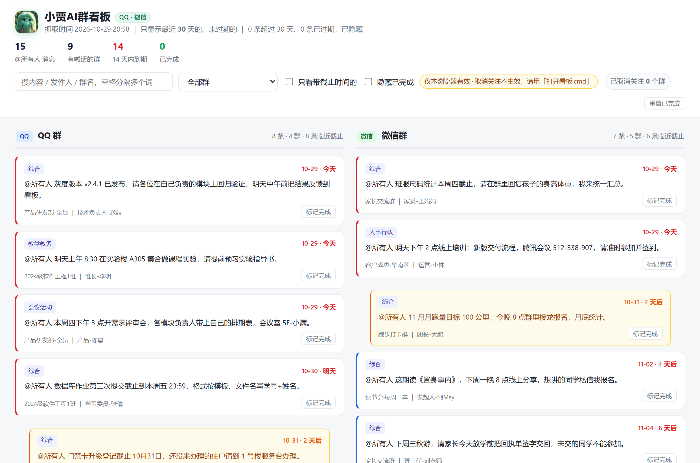

<div align="center">


# 小贾AI群看板

**把 QQ 和微信群里所有「@所有人」的喊话，收成一块左右两列、能标记完成、能退订群的面板。**

不用天天翻几十个群，也不会为了这个去跑什么机器人把号跑封。

<sub>纯本地运行 · 不上传任何聊天数据 · 不需要 root / 不需要注入客户端</sub>

</div>



<sub>截图用的是 `demo/` 里的示例数据（群名、人名均为虚构），不是任何人的真实群。</sub>

---

## 先搞清楚启动顺序（看这一段就够了）

**一句话：项目先起，QQ 后起，而且 QQ 由脚本自己拉 —— 你不用手动开，微信全程不用动。**

1. **先退出 QQ**（如果它正开着）
2. **双击「启动看板.cmd」** —— 看板起来，这一步跟 QQ 完全无关
3. **点右上角「刷新数据」** —— 脚本用 NapCat 拉起 QQ → 抓取 → 自动关掉
4. **想继续用 QQ，自己再打开它** —— 抓完被关掉是设计，不是崩溃

### 为什么「QQ 开着」就抓不到 QQ

NapCat 是把自己注入到一个**新创建**的 QQ 进程里去的。
如果你的 QQ 已经开着，它就注不进去 —— 这时候脚本会**主动跳过 QQ、只抓微信**，
而不是去杀掉你正在用的 QQ。

所以：**「QQ 现在开着」和「这次能抓 QQ」是互斥的**。不怪脚本，这是机制决定的。

### 扫码：只需要一次

脚本是用 `-q <你的QQ号>` 做**快速登录**的，靠的是本机已有的登录态：

| 情况 | 要不要扫码 |
|---|---|
| 这台机器登录过该 QQ（存在 `napcat/config/napcat_<QQ号>.json`） | **不用**，静默登录 |
| 第一次用 / 换电脑 / 换 QQ 号 / 登录态失效 | **扫一次**，之后一直免扫 |

时间也够：脚本拉起 QQ 后先等 8 秒，再给 NapCat 最多 120 秒连上来，
你有大约两分钟扫码。真超了日志会写「等了 120 秒 NapCat 仍未连接」，QQ 也会被自动收掉，
重来一次就行。

> 如果二维码一直没出现，最稳的办法：手动打开 QQ 正常登录一次（勾上自动登录），
> 再关掉 QQ，然后回来点「刷新数据」。

### 微信那边呢

不用管。微信开着就行，你正常聊天，脚本读的是磁盘上的库，全程不重启、不退出。

---

## 它解决什么

你在 30 个群里，每条重要通知都是 `@所有人`。它们散落在各个 App、各个群、各个时间点，
于是你要么天天爬楼，要么直接漏掉「11月3日17:00 前完成评教」这种要命的一句。

这个工具做三件事：

1. **抓** —— 从本机 QQ / 微信的本地数据里，把带 `@所有人`、`@全体成员` 的消息挑出来
2. **排** —— 抠出截止时间，按「今天 / 明天 / N 天后 / 无期限」排好，过期的自动隐藏
3. **看** —— 生成一块 HTML 看板，左 QQ、右微信，两个通道绝不混排

看板上你可以：搜索、按群筛选、只看带截止时间的、点「标记完成」、点 `✕` **取消关注某个群**
（退订后爬虫直接跳过它，彻底不再扫描）。

---

## 为什么不会把号跑封

这是整个项目最花心思的地方。所有「群消息聚合」工具翻车，基本都翻在这两件事上：
**改客户端** 和 **模拟登录**。所以这里两条都不碰。

### QQ：不碰登录，只走本地 OneBot

QQ 侧用 [NapCat](https://github.com/NapNeko/NapCatQQ) —— 它是一个**本地**的 OneBot 实现，
挂在你自己已经登录的 QQ 进程上，消息从本机 WebSocket 出，不经过任何第三方服务器。

关键在于节奏：

```
启动 QQ（快速登录） → 抓（本地 WS，只读） → 抓完立刻退出 QQ
```

NapCat 只能注入**新创建**的进程，所以每天跑的时候先拉起一个干净的 QQ，
抓完就关掉，回到你平时手动登录的状态。全程不发消息、不加好友、不拉群、不点同意，
行为上跟「你自己打开 QQ 翻了一下群」没有区别。

### 微信：根本不用退出

微信的数据库就在磁盘上，只要拿到密钥就能**离线**解密 —— 不需要保持进程、不需要注入。

```
只读扫描微信进程内存取出密钥 → 离线解密数据库副本 → SQLite 查询 → 完成
```

- 对微信进程只做 `PROCESS_VM_READ`（只读），**不写内存、不注入 DLL、不挂调试器**
- 不修改微信安装目录，不碰登录态
- 微信可以一直开着，你正常聊天，后台 6 秒跑完

密钥提取这部分没有自己造轮子，直接用了
[wcdb-key-tool](https://github.com/TANGandXUE/wcdb-key-tool)（MIT），
它解决了微信 4.1+ 不再缓存明文密钥的问题。代码已 vendor 到 `app/vendor/wcdb-key-tool/`。

### 两个通道的差异，一张表

| | QQ | 微信 |
|---|---|---|
| 接入方式 | NapCat + OneBot 反向 WS | 本地 SQLCipher 库离线解密 |
| 需要退出客户端吗 | **需要**（抓完即退） | **完全不用**，一直在线 |
| 每次耗时 | 约 40–90 秒（含启动 QQ） | 约 6 秒（增量） |
| 首次额外开销 | 下 NapCat（点一下就自动下） | 取密钥 12 秒 + 首次解密 7 秒 |
| 抓不到时 | QQ 已开着 → 那一路自动跳过 | 微信没开 + 有旧密钥 → 照样能抓 |

> 说人话：微信是「磁盘上有，随时能读」；QQ 是「只能在它自己新建进程的那一刻读」。
> 所以一个能常驻，一个只能速战速决。

---

## 快速开始

**环境**：Windows 10/11 + Python 3.10 及以上（装的时候记得勾 `Add python.exe to PATH`）

```bat
git clone https://github.com/dynamor2019/xiaojia-group-board.git
cd xiaojia-group-board
```

然后**双击根目录的 `启动看板.cmd`** —— 就这一个入口，其余全在网页里。

那个黑色窗口**几秒后自己就没了，这是对的**：服务已经转到后台，窗口关掉不影响看板。
再双击一次也不会起第二份，只是把浏览器重新打开。

第一次启动会自动做三件事：

1. 没有 `config.json` 就生成一份（想改参数编辑它就行）
2. 缺 Python 依赖就自动 `pip install`（只有一个 `websockets`）
3. 在后台拉起看板服务并打开浏览器

> **想停掉？** 点页面最下方的「停止看板服务」。
> 万一没起来，那个黑窗口会**停住**并把日志尾巴打出来（而不是一闪而过），
> 完整日志在 `data/logs/看板.log`。

打开后右上角有三个按钮：

| 按钮 | 作用 |
|---|---|
| **↻ 刷新数据** | 立刻抓一次（微信 + QQ），日志实时滚在下方黑框里，完事自动重载看板 |
| **环境体检** | 逐项检查 Python / 依赖 / NapCat / QQ 号 / 微信数据目录 / 密钥；缺 NapCat 和缺依赖都能在面板里点一下自动装 |
| **看示例** | 切到 `demo/` 的假数据看效果，不动你的真实群 |

> 第一次点「刷新数据」之前，**记得先把 QQ 退掉** —— 不然 QQ 那一路会被跳过，
> 原因见上面「[先搞清楚启动顺序](#先搞清楚启动顺序看这一段就够了)」。

### 想配 QQ 的话，还差一步

**微信侧开箱即用**（目录自动探测），不用任何额外准备。

QQ 侧需要 [NapCat](https://github.com/NapNeko/NapCatQQ)，**不用手动去 GitHub 下载**：

1. 双击「启动看板.cmd」，点右上角「环境体检」
2. 看到 `NapCat 没找到 …` 那行，**点它下面的「⬇ 下载 NapCat」** —— 自动下 34 MB、
   解压到项目下的 `napcat\`，进度会实时打在面板里，装完自动复查变绿
3. 在 `config.json` 里填上 `qq.uin`
4. 点一次「刷新数据」，QQ 被拉起来后扫码（就这一次，之后免扫码）

也支持命令行，适合没有浏览器的场合：

```bat
python app\launch.py napcat
```

> **下不动怎么办？** 公司网络／代理挡住 GitHub 时，自动下载会失败并打印日志。
> 手动方案一样简单：去 [Releases](https://github.com/NapNeko/NapCatQQ/releases) 下
> `NapCat.Shell.zip`（**别下 OneKey，那个要人点**），把解压出来的文件**全部**放进
> 体检提示的那个 `napcat` 目录，再点一次「环境体检」即可。
>
> 重复下载不会顶掉你的登录状态 —— 解压时会跳过 `napcat\config\` 里已有的文件，
> 所以升级 NapCat 之后不用重新扫码。

> 不想碰 QQ 就把 `config.json` 里的 `qq.enabled` 改成 `false`，只当微信看板用，一样好用。

> **为什么一个"看板"要起个本地服务？** 因为浏览器不允许网页直接写磁盘文件，
> 而「取消关注某个群」「标记已完成」必须落到 `data/board_state.json`，爬虫下次才知道要跳过。
> 这个服务只用 Python 标准库，跑在 `127.0.0.1:8766`，只监听本机，不对外开端口。

---

## 配置项

| 键 | 默认 | 说明 |
|---|---|---|
| `days` | `30` | 看板只显示最近多少天 |
| `qq.enabled` | `true` | 关掉就完全不动 QQ |
| `qq.uin` | `""` | QQ 号。不填就只能手动开 QQ 再抓 |
| `qq.napcat_dir` | `""` | NapCat 目录，留空用项目下的 `napcat\` |
| `qq.exe` | `""` | `QQ.exe` 路径，留空自动找常见安装位置 |
| `qq.ws_port` | `8765` | OneBot 反向 WS 端口 |
| `qq.pages` | `15` | 每个群最多翻几页（每页 100 条） |
| `wechat.enabled` | `true` | 关掉就完全不动微信 |
| `wechat.db_dir` | `""` | `db_storage` 路径，留空自动探测 |
| `wechat.process` | `"Weixin.exe"` | 微信进程名（4.x 是 `Weixin.exe`，3.x 是 `WeChat.exe`） |
| `board.port` | `8766` | 看板服务端口，被占用会自动往后找 |
| `board.open_browser` | `true` | 启动时自动开浏览器 |
| `paths.data_dir` | `""` | 抓取结果放哪，留空=`data/` |
| `paths.work_dir` | `""` | 解密产物放哪，留空=`app/vendor/wcdb-key-tool/` |

---

## 定时跑

想每天自动刷新，用 Windows 任务计划，填三格：

```
程序或脚本： C:\Program Files\Python311\python.exe
添加参数：   -X utf8 app\launch.py update
起始于：     C:\path\to\xiaojia-group-board
```

注意两点：

- **QQ 侧如果当时 QQ 已开着，那一路会跳过**（NapCat 需要一个新进程），微信侧不受影响，
  这种跳过不算失败，返回码是 0
- 看板常驻不用管：把 `启动看板.cmd` 的快捷方式放进启动文件夹，之后打开
  `http://127.0.0.1:8766/` 就行

---

## 目录结构

根目录只有 4 样东西：**一个 .cmd、一份 README、一份配置、一块看板**，代码全在 `app/` 里。

```
xiaojia-group-board/
├─ 启动看板.cmd          ← 唯一入口，双击它就够了
├─ config.json           ← 自动生成，想改参数编辑它
├─ 小贾AI群看板.html      ← 自动生成的看板
├─ app/                  ← 全部代码
│  ├─ launch.py          启动 + 自检 + 自动装依赖
│  ├─ serve_board.py     本地服务：看板 + 刷新 + 体检（只用标准库）
│  ├─ settings.py        配置读取与路径约定
│  ├─ update_wx.py       微信一键：取密钥 → 解密 → 抓 → 重出看板
│  ├─ wx_crawl.py        从解密后的微信库里抠 @所有人
│  ├─ auto.py            QQ 一键：启动 → 抓 → 退出
│  ├─ crawl_ws.py        通过 OneBot 反向 WS 抓 QQ 群消息
│  ├─ digest.py          规则式抠截止时间、判断要不要动手
│  ├─ report.py          渲染看板（自包含单 HTML，图也内嵌）
│  ├─ board_state.py     已完成 / 已退订群的唯一真相
│  ├─ napcat_setup.py    自动下载 / 升级 NapCat
│  └─ vendor/            微信密钥提取（MIT，第三方）
├─ napcat/               ← 一键下载的 NapCat（用完才有）
├─ data/                 ← 抓取结果、状态、日志
├─ assets/               logo、截图
├─ demo/                 示例数据
└─ docs/                 技术原理
```

---

## 常见问题

**Q：微信那一侧提示「一个库都没解开」**
密钥失效了（换了账号、微信重建了库）。用 `python app/update_wx.py --force` 重新提取。
前提是微信**正在运行**，密钥只能从活动进程里取。

**Q：微信必须开着才能跑吗？**
不需要。密钥取到一次会存下来，之后微信关着也能离线解密。
但新消息要等微信把消息写进库，所以想抓最新的还是让微信开着顺便聊。

**Q：QQ 侧一条都没抓到**
按顺序排查：① 体检里 NapCat 是不是绿的，没绿就点「⬇ 下载 NapCat」；② QQ 号填了没；
③ 跑的时候 QQ 是不是已经开着（那就跳过了）；④ 群里最近真的没有 `@所有人`。

**Q：NapCat 自动下载失败**
GitHub 连不上（代理 / 公司网络）。面板会打印失败原因，并给出手动方案：
去 [Releases](https://github.com/NapNeko/NapCatQQ/releases) 下 `NapCat.Shell.zip`，
解压出来的文件全部丢进体检提示的那个 `napcat` 目录即可。选 Shell 版，**别选 OneKey**。

**Q：消息比预期少**
默认只留最近 `days` 天、且**没过期**的。头部那行会写「N 条超过 30 天、M 条已过期，已隐藏」，
不是吞了，是被时间窗口挡掉了。

**Q：换电脑 / 换目录后打不开**
看板是用绝对路径生成的，重新点一次「刷新数据」就行。

**Q：能不能抓私聊、抓图片、抓所有消息？**
不能，也刻意不做。只抓群里的 `@所有人` / `@全体成员` 文字消息 ——
既能覆盖「重要通知」这个场景，又把碰到的数据面压到最小。

---

## 隐私与安全

- 所有数据**只存在你自己电脑上**，没有任何上报接口，代码里也没有埋点
- 解密出来的明文库在 `app/vendor/wcdb-key-tool/decrypted/`，跟你的聊天记录同等敏感，
  `.gitignore` 已排除，**别提交、别分享**
- 密钥文件 `all_keys.json` 同理，泄露等于泄露数据库
- 唯一的网络访问是 NapCat 与你本机之间的 WebSocket（`127.0.0.1`）

---

## 已知限制

- QQ 侧依赖 NapCat，它随 QQ 版本更新偶尔需要升级
- 微信侧只支持 4.x 的 WCDB 库格式；3.x 的库结构不同，需要另行适配
- 看板的「已完成」状态存在本机文件里，不跨设备同步
- 退订的群只是不再扫描，历史数据仍留在对应 JSON 里（想看可以手动查）

---

## 深入

想搞清楚「微信 4.1+ 为什么让所有旧工具失效」「SQLCipher 的页结构长什么样」
「稳定 ID 为什么会导致已完成标记失灵」这些细节，看
[`docs/技术原理.md`](docs/技术原理.md) —— 踩过的坑都写在里面。

---

## 致谢

- [NapCatQQ](https://github.com/NapNeko/NapCatQQ) —— 让 QQ 侧不用碰登录态
- [wcdb-key-tool](https://github.com/TANGandXUE/wcdb-key-tool) —— 解决了微信 4.1+ 的密钥提取
- 以及每一个被 `@所有人` 折磨过的人

## 协议

[MIT](LICENSE)。第三方代码的许可证见各子目录。
